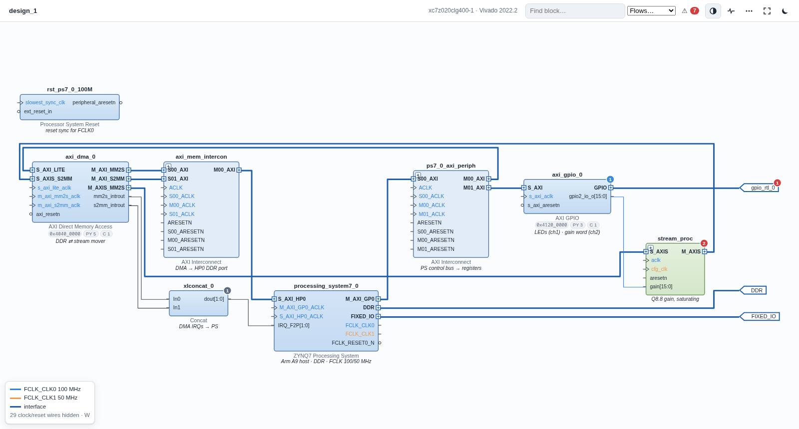
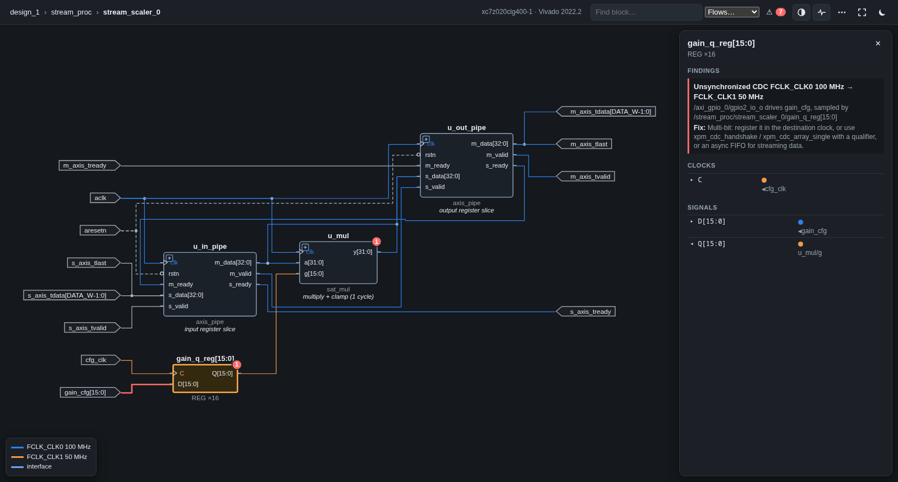
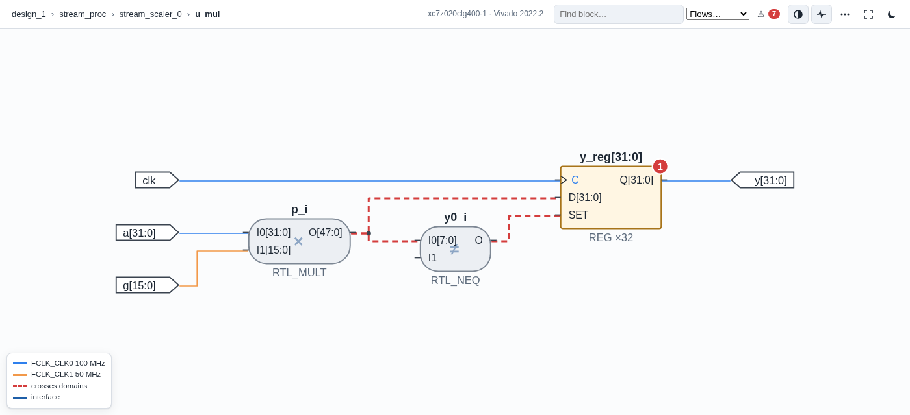

<p align="center"></p>

<h1 align="center">FPGA Project Analyzer</h1>

<p align="center"><b>Understand any Vivado, Zynq or PYNQ project in minutes - visually.</b><br>
An AI agent skill that turns an existing FPGA project into a drill-down, Vivado-style diagram<br>
and finds the bugs that "timing met" hides.</p>

<p align="center">


</p>

---

## Why

Inherited FPGA projects are hard to read: a Block Design in one tool, RTL in another, constraints, a PYNQ
notebook, a 300 KB hardware handoff and a 1,000-line failed build log. This skill lets your AI agent read all
of it with scripts and hand you **one picture you can click into** - plus a short list of what will break on
real hardware.

<table>
<tr>
<td width="50%"></td>
<td width="50%"></td>
</tr>
<tr>
<td>Click a block to go inside: Block Design → hierarchy → module reference → Verilog → VHDL.
Wires are coloured by clock domain; the red wire is an unsynchronized crossing.</td>
<td>With Vivado installed, the lowest level is the real elaborated netlist (RTL_REG, RTL_MUX, operators),
grouped into buses like Vivado's schematic.</td>
</tr>
</table>

## What you get

- **See it.** One offline HTML file in the style of Vivado IP Integrator: interfaces, clocks with domain
  colours, active-low bubbles, address chips, software tags. Breadcrumbs, search, deep links, dark mode.
- **Bugs that break hardware**, traced across tool boundaries: a clock-domain crossing that starts at an AXI
  GPIO in the Block Design and lands on a register inside your VHDL; unconstrained pins that will fail
  `write_bitstream`; reset polarity mismatches; overlapping or unmapped addresses; unrouted interrupts;
  PYNQ overlay mistakes (`.bit`/`.hwh` names, IP names, MMIO outside the map).
- **Failed builds in four lines.** Vivado, HLS, PetaLinux/Yocto and gcc logs are grouped by message ID, with
  the "Problem ports" detail kept and the Yocto task log path surfaced.
- **Software ↔ hardware.** PYNQ notebooks (including aliases like `dma = ol.axi_dma_0`), bare-metal C
  (`XPAR_*`, base addresses), device trees and HLS pragmas are pinned to the blocks they drive.
- **Interrupts and memory map, decoded.** `IRQ_F2P[1] → GIC 62 (DT <0 30 4>)`, base/range per slave,
  register maps with bit-field bars from the `.hwh`.
- **Token-lean by design.** Scripts parse; the agent reads a ~40-line summary and asks for single blocks.
  `SKILL.md` is under 70 lines; the checklist loads only when needed.

## The demo bug

[`examples/zynq_dma_scaler`](examples/zynq_dma_scaler) is a PYNQ-Z2 design: PS → AXI DMA → a custom RTL gain
stage → DMA. Vivado says **"All user specified timing constraints are met."** The analyzer reports:

```
H io-unconstrained  /  gpio_rtl_0_tri_o[3]: no IOSTANDARD / PACKAGE_PIN          ← why write_bitstream failed
H cdc  /stream_proc/stream_scaler_0/gain_q_reg   16-bit CDC FCLK_CLK0 100 MHz → FCLK_CLK1 50 MHz
H cdc  /stream_proc/stream_scaler_0/u_mul/y_reg  CDC FCLK_CLK1 → FCLK_CLK0 through logic (VHDL)
M pynq-bitname  Notebook loads design_1.bit but the build makes design_1_wrapper.bit
M methodology  TIMING-6/7: clocks timed as related, so "timing met" proves nothing here
```

Both crossings were found without Vivado and match what Vivado's own `report_cdc` reports on the routed design.
An agent using the skill then read the flagged RTL and found a fifth bug no tool flagged: the multiplier adds a
register stage that `valid`/`last` don't get.

## Install

**Claude Code**

```
/plugin marketplace add al-nafisah/fpga-project-analyzer
/plugin install fpga-project-analyzer@fpga-project-analyzer
```

**Other agents** that read the Agent Skills `SKILL.md` format: copy
[`skills/fpga-project-analyzer`](skills/fpga-project-analyzer) into the agent's skills folder.

Requirements: Python 3.8+ (standard library only). Vivado is optional and auto-detected.

## Use

Open your project folder in your agent and ask, for example:

- "Explain how this FPGA project works."
- "Why did my bitstream build fail?"
- "Review the clock-domain crossings in this design."
- "Which blocks does this PYNQ notebook talk to?"

The agent runs the scripts, writes short role notes and data-flow highlights onto the diagram, and gives you
a link to `.fpa/design.html`. You can also run it yourself:

```bash
FPA="python3 skills/fpga-project-analyzer/scripts/fpa.py"
$FPA build   path/to/project            # extract + check, prints the summary
$FPA show    /axi_dma_0 path/to/project # one block: pins, peers, domains, address, registers, refs
$FPA view    path/to/project            # → path/to/project/.fpa/design.html
$FPA logs    path/to/runme.log          # grouped errors of a failed run
$FPA deep    path/to/project --top my_module   # Vivado-elaborated netlist (needs Vivado)
```

## Inputs

| Source | Read from |
|---|---|
| Vivado project | `.xpr` (sources, constraints, part, top) |
| Block Design | `.bd`, `.hwh`, `.xsa`, or BD Tcl (built-in Tcl interpreter, no Vivado needed) |
| RTL | Verilog, SystemVerilog, VHDL (mixed); module references and custom IP linked to their RTL |
| Constraints | `.xdc` (pins, I/O standards, clocks) |
| Reports and logs | timing, utilization, DRC, methodology, CDC reports; Vivado/HLS/PetaLinux/gcc logs |
| Software | PYNQ `.ipynb`/`.py`, bare-metal C/C++, HLS pragmas, `.dts`/`.dtsi` |

Devices: Zynq-7000, Zynq UltraScale+ MPSoC, 7-series / UltraScale / UltraScale+ FPGAs.
Tool flows: Vivado / Vitis / PetaLinux 2023.2-2024.2. Live Vivado integration was tested with 2022.2; the
`.bd`/`.hwh` formats it reads are shared across these releases - please open an issue if a file does not parse.

## How it works

```
project ─┬─ .bd / .hwh / .xsa / BD Tcl ─┐
         ├─ Verilog / SV / VHDL ────────┤
         ├─ Vivado netlist (optional) ──┼─▶ one design model ─▶ checks + clock-domain analysis
         ├─ .xdc, reports, logs ────────┤                         │
         └─ notebooks, C, device trees ─┘                         ├─▶ ~40-line summary (agent)
                                                                  └─▶ offline HTML diagram (you)
```

The clock-domain analysis follows every clock to its source (through hierarchy, module references and clock
buffers), propagates each net's driving domains through logic and into submodules, and flags registers that
sample another domain - unless it is a proper two-flop synchronizer.

## Privacy

Everything runs on your machine. The diagram is a single file with no network requests (the ELK layout
engine is embedded), so proprietary designs never leave your disk.

## Credits

Created by **Abdullah AlNafisah**, built with [Claude Code](https://claude.com/claude-code).
Diagram layout by [ELK](https://eclipse.dev/elk/) (elkjs, EPL-2.0, vendored in
`skills/fpga-project-analyzer/assets/vendor`).

AMD, Xilinx, Vivado, Vitis, Zynq and PYNQ are trademarks of Advanced Micro Devices, Inc. This project is
independent and not affiliated with or endorsed by AMD.

## License

Copyright © 2026 Abdullah AlNafisah. All rights reserved. See [LICENSE](LICENSE).
