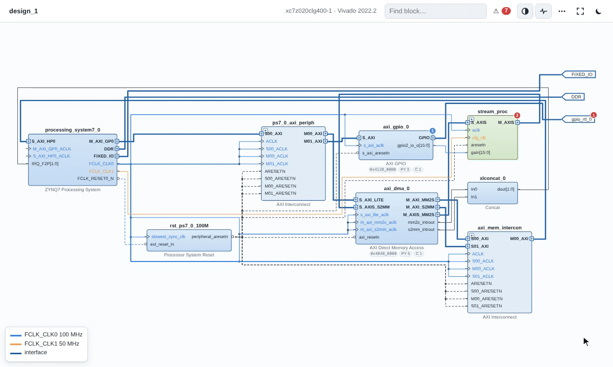

<p align="center"></p>

<h1 align="center">FPGA Project Analyzer</h1>

<p align="center"><b>See and review any Vivado, Zynq or PYNQ project - visually.</b><br>
Drill-down Vivado-style diagrams, plus the bugs that "timing met" hides. A CLI and an AI agent skill.</p>

<p align="center">


</p>

<table><tr>
<td width="50%"></td>
<td width="50%"></td>
</tr></table>

## Features

- **Diagram:** one offline HTML file. Click from block design → hierarchy → Verilog/VHDL → registers; wires
  coloured by clock domain.
- **Checks:** clock-domain crossings traced from the block design into RTL, unconstrained pins, reset polarity,
  address map, interrupts, PYNQ `.bit`/`.hwh` mistakes.
- **Logs:** failed Vivado/PetaLinux builds condensed to the lines that matter.
- **Software links:** PYNQ notebooks, bare-metal C and device trees mapped to the blocks they drive.

## Demo

[`examples/zynq_dma_scaler`](examples/zynq_dma_scaler): Vivado reports timing met; the analyzer finds

```
H io-unconstrained  gpio_rtl_0_tri_o[3]: no IOSTANDARD / PACKAGE_PIN   ← why write_bitstream failed
H cdc  .../gain_q_reg   16-bit CDC 100 MHz → 50 MHz                     (Vivado report_cdc agrees)
H cdc  .../u_mul/y_reg  CDC 50 MHz → 100 MHz through logic             (Vivado report_cdc agrees)
M pynq-bitname  notebook loads design_1.bit, build makes design_1_wrapper.bit
```

## Install

In Claude Code:

```
/plugin install fpga --marketplace al-nafisah/fpga-project-analyzer
```

<sub>Older Claude Code: `/plugin marketplace add al-nafisah/fpga-project-analyzer`, then `/plugin install fpga@fpga-project-analyzer`.
Other agents: copy [`skills/`](skills) into the agent's skills folder. Needs Python 3.8+; Vivado optional.</sub>

## Use

Open your project folder in Claude Code and type:

| Command | What you get |
|---|---|
| `/fpga:explain` | How the design works, as a clickable diagram |
| `/fpga:review` | Hardware bugs: clock crossings, pins, resets, address map, PYNQ |
| `/fpga:debug build.log` | Why the build failed, and the exact fix |

Each takes an optional folder or file. Or just ask in plain words, e.g. *"why did my bitstream fail?"*.

## Limitations

Without Vivado, RTL is read structurally: clocks routed through SystemVerilog interface internals may go
untraced, so "no findings" can mean "not checked". `fpa.py deep` uses Vivado elaboration for exact results.
Findings are candidates to confirm against the source.

## Credits

Created by **Abdullah AlNafisah**, built with [Claude Code](https://claude.com/claude-code). Layout by
[ELK](https://eclipse.dev/elk/) ([THIRD_PARTY.md](THIRD_PARTY.md)). AMD, Vivado, Zynq and PYNQ are trademarks
of AMD; this project is not affiliated with AMD.

[MIT](LICENSE) © 2026 Abdullah AlNafisah
